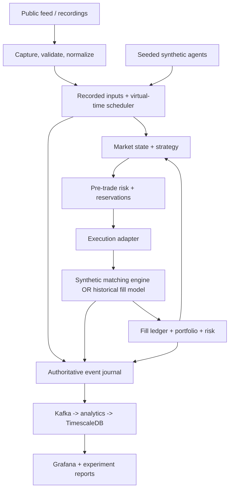

# MarketLab: deterministic trading systems and execution research

Status: project blueprint; implementation has not started.

## Project thesis

Build a small exchange simulator and research platform that answers:

> How do execution latency, liquidity, data failures, and risk controls change a strategy's fills, profit and loss, and survival?

Combine a matching engine, market data pipeline, event-driven backtester, and risk engine around one versioned event model and deterministic runtime. The distinguishing feature is the ability to reconstruct an incident, branch from a checkpoint, change one assumption, and explain the difference.

Initial scope: one spot instrument, one venue adapter, one currency of account, simulated trading, and a single-process authoritative runtime. Add multiple instruments only after correctness and reproducibility are demonstrated.

## Architecture



Kafka and analytics consume the authoritative journal asynchronously. They do not decide order priority or authorize trading. FastAPI controls runs, exposes state, and starts experiments. A TCP gateway can be added when measuring network order-entry performance.

## Recommended implementation stack

| Component | Choice | Purpose |
| --- | --- | --- |
| Matching, scheduler, ledger, pre-trade checks | C++20 | Predictable memory ownership and a measurable systems core |
| Build and correctness checks | CMake, CTest, sanitizers where supported | Reproducible builds and memory correctness |
| Strategies and experiment orchestration | Python with a narrow pybind11 boundary | Accessible research interface; report Python overhead separately |
| Control API | FastAPI | Run configuration, replay control, results, health |
| Streaming layer | Kafka, added after the local vertical slice | Durable analytics distribution and recovery exercises |
| Time-series projections | TimescaleDB | Time-indexed queries plus transactional deduplication and checkpoints |
| Portable datasets | Raw captures and Parquet exports | Reproducible offline experiments |
| Operational dashboard | Prometheus and Grafana | Queue lag, latency, feed health, portfolio and risk visibility |
| Development | Docker Compose; native core benchmarks | Repeatable services without hiding benchmark environment differences |

On Windows, use a consistent native or WSL2 build environment for a benchmark series. Record the environment and do not mix measurements across them without labeling the comparison.

## Four integrated subsystems

### 1. Exchange and matching engine

- Limit and market orders, FIFO within a price level, partial fills, cancel, GTC and IOC.
- Trade at the resting order's price. A market order never rests; cancel any unfilled remainder.
- Define duplicate order ID behavior, cancel-after-fill behavior, invalid tick/lot rejection, and self-trade policy explicitly.
- Represent prices and quantities as integer ticks and lots. Check multiplication and accumulation for overflow.
- Start with an ordered price map, FIFO lists, and an order-ID index storing stable handles.
- Compare with a bounded tick-indexed price ladder, bitmap for nonempty levels, and preallocated order pool.
- Indexed order unlinking can be constant time; removing a now-empty level from a tree still costs logarithmic time. Report those distinctions.
- Give the ladder an explicit supported price range and out-of-range policy. Measure its memory cost and behavior under sparse prices.
- Keep one writer per book. Begin with one runtime thread; do not introduce concurrent cross-account risk races before they can be tested.

### 2. Market data pipeline

- Preserve raw messages before normalization and keep connection/session identity.
- Capture trades and depth, including exchange event time, local receipt time, source sequence/update IDs where available, and a local ingestion sequence.
- Follow the selected venue's snapshot-plus-delta synchronization protocol. Do not treat depth deltas as individual orders.
- Detect gaps, duplicates, disconnects, stale data, and bounded-queue overflow. Mark invalid book intervals and resynchronize before resuming dependent decisions.
- Compute rolling trade VWAP, realized return volatility, spread, depth, and top-N-level imbalance. Specify windows and undefined-value behavior.
- Preserve information availability in replay: late messages must not silently rewrite what a strategy knew earlier.
- Use at-least-once delivery with idempotent projections. In TimescaleDB/Postgres, commit a consumer checkpoint and its ledger/projection effects together, with uniqueness constraints compatible with partition keys.
- Broker idempotence does not imply that an external database update or portfolio mutation happens exactly once.

### 3. Backtesting and portfolio accounting

- Use a virtual clock and deterministic event scheduler; no wall-clock sleeps in simulation.
- Share strategy interfaces, order validation, accounting, and risk rules across offline replay and live shadow operation.
- Model market-data delivery delay, strategy computation delay, outbound order delay, and execution-report delay separately.
- Schedule strategy decisions only after the relevant information becomes available to that strategy.
- Track cash, inventory, cost basis, realized and unrealized PnL, maker/taker fees, and outstanding reservations.
- Use a simple inventory-aware market maker as the main demonstration strategy. Add TWAP as an execution baseline.
- Use fixed seeds for reproducibility; compare several seeds for stochastic models and report variation.
- Run parallel parameter sweeps as isolated processes. Use chronological train/validation/test periods and report all selected experiment settings.

### 4. Risk engine

- Pre-trade: order quantity/notional caps, inventory bounds, available cash/inventory reservations, price collars, and market-data freshness checks.
- Make validation and reservation atomic within the authoritative runtime so several outstanding orders cannot spend the same resources.
- Release reservations on rejection, cancellation, and fills according to explicit ledger rules.
- Post-trade: positions, cash, exposure, PnL, drawdown, and breach events, updated on fills and marks.
- Historical VaR and expected shortfall run periodically from a specified return window and horizon. Display insufficient-history states and stale results explicitly.
- A loss/drawdown threshold can trigger a documented policy: cancel resting orders and reject exposure-increasing orders. Liquidation is a separate explicit simulation action.
- Keep expensive statistical calculations off the order-entry path.

## Three execution modes and their limits

1. Synthetic exchange: seeded background agents and the strategy submit actual orders to our matching engine. The engine knows FIFO position and endogenous fills exactly within the simulated model. The market behavior is synthetic, not a claim about a real venue.
2. Historical replay: reconstruct observed market state and estimate hypothetical fills using a separate execution adapter. Level-2 updates do not reveal individual order identities, queue priority, hidden liquidity, or the market's response to our hypothetical trades. Label fill and impact assumptions and prevent repeated consumption of the same modeled liquidity.
3. Live shadow: consume live data and generate paper orders with the historical execution adapter. Include real capture delays and data health checks, but do not describe these fills as exchange confirmations.

## Novelty to prioritize

### A. Branchable incident replay

Checkpoint the book, portfolio, open orders, reservations, scheduled events, strategy state, random-generator state, and relevant configuration. Resume at an event boundary and change one controlled assumption: delay, fee, position cap, or liquidity scenario.

Compare baseline and branch by fills, rejected orders, inventory, PnL, drawdown, and execution cost. In historical mode this is a counterfactual under fixed observed market data; it does not establish how the real market would have reacted.

### B. Execution uncertainty experiments

Run conservative, baseline, and optimistic queue/fill assumptions against the same recording. Show whether a strategy's apparent advantage survives less favorable execution.

These are scenario envelopes, not calibrated statistical confidence intervals. Validate model parameters against observable data where possible and publish assumptions beside results.

### C. Explainable fault injection

Inject duplicates, delayed messages, missing depth updates, reconnects, slow consumers, and process crashes. Every fill/rejection links to its order, strategy decision, source observations, risk snapshot, and model configuration.

The incident report should answer: what information was available, what action followed, which control fired, and whether replay recovered the same authoritative state.

## Determinism and recovery contract

Each event carries schema version, run ID, instrument, type, payload, source identity, source sequence if present, ingestion sequence, simulated availability time, and causal parent IDs. Keep wall-clock telemetry separate from fields used in deterministic state hashes.

- Record a total order for authoritative runtime inputs. Do not assume exchange timestamps establish a total order across channels.
- Use explicit deterministic tie-breaking for scheduled events with equal times.
- Save a run manifest: code revision, data checksum, instrument specification, fee/risk settings, execution model, seed, and build environment.
- Define the supported reproducibility scope. Start with the same build and platform; use fixed-point accounting and canonical serialization for state hashes.
- Snapshot plus journal replay must reproduce a complete uninterrupted run's book, ledger, reservations, and deterministic output hash.
- In durable gateway mode, acknowledge acceptance only under the documented journal durability rule. Benchmark group-commit versus stricter sync separately from in-memory processing.
- The journal publisher can resend after restart. Event identities and consumer checkpoints make projection recovery idempotent.

## Benchmark and validation plan

### Correctness gates

- Targeted cases: FIFO at equal price, crossing several levels, partial fill then cancel, empty-book market order, IOC remainder, invalid ticks, duplicate commands, and depleted cash/inventory.
- Differential tests: compare optimized implementations against a deliberately simple reference matcher on seeded generated command sequences.
- Invariants: no negative resting quantity; book totals equal order totals; no crossed resting book after a command; each order's original quantity reconciles to filled, canceled, and remaining quantity.
- Ledger conservation includes both counterparties and the fee account in synthetic mode. Historical simulation uses an explicit external counterparty account.
- Recovery tests inject interruption around journal writes, acknowledgments, checkpoint writes, database commits, and Kafka offset commits.
- Feed tests include snapshot/delta races, stale duplicates, genuine gaps, delayed trades, and invalid intervals.
- Lookahead test: deliberately delay an input and verify no strategy event uses it before its availability time.

### Performance measurements

Measure separately:

1. In-memory matcher service time and commands/second.
2. Full runtime latency including scheduling, pre-trade checks, accounting, and journaling under a stated durability mode.
3. Gateway round-trip latency, including queueing and serialization.
4. Pipeline event lag, database visibility lag, backlog, and recovery time.

For each, publish p50/p95/p99/p99.9 where sample count supports it, achieved and offered load, rejects/drops, memory use, and workload distribution. Use a monotonic clock for elapsed durations.

Use an open-loop load generator that schedules arrivals independently of responses; include generator lateness and queueing in latency accounting. This avoids hiding overload by sending fewer requests when the engine slows down.

Compare map versus ladder on the same prerecorded commands and identical outputs. Include shallow/deep books, dense/sparse prices, varying cancel ratios, multi-level sweeps, and bursts. Record hardware, compiler flags, warm-up, sample size, repeated-run variation, and data checksums. Do not invent a throughput target or claim measured results before running the experiment.

## Delivery milestones

Indicative scope for one developer already comfortable with C++ and Python: 8-12 focused weeks; learning either language substantially extends it.

| Milestone | Deliverable | Completion evidence |
| --- | --- | --- |
| 1. Correct exchange core | Matcher, command/event schema, simple reference engine, synthetic CLI replay | Matching cases and generated differential checks pass |
| 2. First integrated experiment | Virtual clock, strategy, fill ledger, reservations, basic risk | Seeded end-to-end run produces identical authoritative output twice |
| 3. Real data | One feed adapter, capture, reconstruction, historical execution model | Recorded session replays; gaps invalidate state; fees and latency alter outcomes |
| 4. Streaming and operations | Kafka, TimescaleDB, FastAPI, Grafana, Compose | Restarting a consumer causes no duplicate ledger effects; lag and feed health visible |
| 5. Distinctive research features | Checkpoints, branching, execution scenarios, fault injection | Reproduce one incident and compare controlled branches with causal explanations |
| 6. Performance study | Second book structure, harness, published experiments | Identical outputs; reproducible throughput/latency/memory comparison |

Keep the first working slice small: one instrument, a synthetic session, one strategy, basic limits, and a CLI report. Add multi-asset account risk, a second venue, smart order routing, or reinforcement learning only after these milestones.

## Suggested repository layout

```text
core/                 # matcher, scheduler, ledger, risk, journal
bindings/             # Python interface
python/marketlab/      # strategies, adapters, experiment runners
gateway/              # FastAPI control plane; optional TCP order entry
schemas/              # versioned commands/events and instrument metadata
tests/                # reference matcher, properties, recovery, fixtures
benchmarks/           # generator, workloads, result analysis
experiments/          # scenario configs and reproducibility manifests
infra/                # Compose and observability configuration
docs/                 # architecture decisions, execution assumptions, reports
data/                 # small fixtures only; large captures excluded from Git
```

## Portfolio demonstration

Replay a volatile session with an inventory-aware market maker. Compare 1 ms, 10 ms, and 50 ms simulated outbound order delays while keeping the recording, strategy configuration, and other assumptions fixed. Inject a feed gap, show the stale-data policy blocking new exposure, and replay from a checkpoint to verify recovery. Compare the risk-enabled run to a controlled simulation branch with a different limit. Display fill-model sensitivity and publish a separately measured data-structure benchmark.

Deliver a short demo recording, architecture diagram, one-command synthetic reproduction, a small redistributable fixture, execution-assumption document, and an honest benchmark report. A losing strategy with credible execution and a well-explained incident is still a successful systems project.

## Primary references checked during planning

- Binance spot streams and depth message schemas: https://developers.binance.com/docs/binance-spot-api-docs/web-socket-streams
- Coinbase channel semantics, snapshots, lifecycle messages, and dropped-match handling: https://docs.cdp.coinbase.com/exchange/websocket-feed/channels
- Kafka delivery guarantees and external-system transaction boundaries: https://docs.confluent.io/kafka/design/delivery-semantics.html

Select and verify the exact feed/channel available in the development environment before implementing its adapter. Keep synthetic fixtures available so project development never depends on live connectivity.
